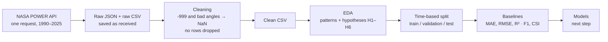

# Time-series--data_Weather

# Cairo Weather: Can We Forecast Tomorrow?

Time-series EDA and forecasting setup for **Cairo, Egypt**, using 36 years of daily data (1990–2025) from the **NASA POWER API**.

**Goal:** understand the data well enough to forecast two things for tomorrow:

| Target | Task | Definition |
|---|---|---|
| Mean temperature | Regression | `temp_mean` of the next day (°C) |
| Rain | Classification | Next day has ≥ 1 mm of rain (yes / no) |


---

## Pipeline



**Rules followed throughout:**
1. The raw data is never changed.
2. No rows are dropped.
3. Wrong values become `NaN`; only short gaps (≤ 3 days) are filled.
4. Real extreme days are kept.
5. Anything learned from the data (normals, thresholds) uses training years only.

---

## Repository structure

```
cairo-weather-forecasting/
├── cairo_weather_forecasting.ipynb   # full analysis, Parts 1–4 + Appendix
├── figures/                          # key figures from the notebook
│   ├── 01_daily_variables_1990_2025.png
│   ├── 02_missing_wind_direction.png
│   ├── 03_cairo_climate_overview.png
│   ├── ...
│   └── 17_train_validation_test_split.png
├── presentation/                     # slides (PDF)
├── requirements.txt
├── .gitignore
└── README.md
```

**Notebook outline**

| Part | What it covers |
|---|---|
| 1 · Data collection | Call the API, save the raw JSON and a CSV |
| 2 · Preparation | Dates, gaps, duplicates, missing and impossible values, clean CSV |
| 3 · EDA | Descriptive stats, temporal patterns, decomposition and structure, relationships and anomalies, decisions |
| 4 · Forecasting setup | Time split, metrics, baselines to beat |
| Appendix | Dashboards, hypotheses H2 and H4–H6, storms |

---

## Data

| | |
|---|---|
| **Source** | [NASA POWER](https://power.larc.nasa.gov/) daily point API (free, no API key) |
| **Location** | Central Cairo, 30.04° N, 31.24° E |
| **Period** | 1990-01-01 to 2025-12-31 · 13,149 days · no gaps, no duplicates |
| **Variables** | `T2M`, `T2M_MAX`, `T2M_MIN`, `PRECTOTCORR`, `RH2M`, `WS2M`, `PS`, `WD2M` (mean / max / min temperature, rain, humidity, wind speed, pressure, wind direction) |
| **Units** | Already metric (°C, mm/day, %, m/s, kPa, degrees) |


---

## EDA process

### Part 2 · Understanding and preparing the data
| Step | What was checked | Result |
|---|---|---|
| 2.1 Understand the data | `head`, `tail`, `shape`, `dtypes`, `describe`, `nunique` | `wind_dir` has values down to −9000 |
| 2.2 Date index, gaps, duplicates | Full daily date range, duplicated dates and rows | 13,149 days, no gaps, no duplicates |
| 2.3 Every variable over time | One line plot per variable | Wind direction breaks in 2013; rain jumps in 2016 |
| 2.4 Missing values | `-999` and negative angles → `NaN` | 4.5 % of the table, all in `wind_dir` (2013–2025) |
| 2.5 Impossible values | Negative rain, min > max, humidity outside 0–100 %, negative wind | None found |
| 2.6 Decision and save | Short gaps filled (≤ 3 days), wind direction left empty | Clean CSV saved |


### Part 3 · Exploratory data analysis
| Step | Method | Main finding |
|---|---|---|
| 3.1 Descriptive | Summary stats, skew, rain-day counts, histograms + KDE | Temperature has two peaks (winter / summer); only 2.9 % of days have ≥ 1 mm of rain |
| 3.2 Temporal patterns | Full range, rolling means, yearly trend, boxplots by month, weekly check, rolling std | Season dominates; Cairo is warming (H1); rain jumps in 2016 (H3); spring is the most unstable season |
| 3.3 Decomposition and structure | Additive vs multiplicative decomposition, ACF / PACF, ADF test | Season 19.1 °C, trend 2.8 °C, residual 2.2 °C; only the last ~5 days matter; stationary |
| 3.4 Relationships and anomalies | Spearman correlation (raw and deseasonalized), rolling-window outliers (31 days, \|z\| > 3), suspicious values | Many raw links are just the shared season; 104 outliers that match real events, kept |
| 3.5 From EDA to modeling | Decision table | See below |


---

## Hypotheses

| # | Question | Answer |
|---|---|---|
| **H1** | Is Cairo warming, and are nights warming faster than days? | **Yes.** Nights +0.41 °C and days +0.23 °C per 10 years |
| **H2** | Are very hot days (> 40.1 °C) becoming more frequent? | **Partly.** 7 in 2013 vs 38 in 2024; 2023–2024 are the most extreme |
| **H3** | Did heavy rain really increase after 2016, or did the data change? | **Most likely the data** (see below) |
| **H4** | Are cold waves (< 5.7 °C) becoming rarer? | **Yes, slowly.** 20.4 nights per year (1990s) to 15.5 (2020s) |
| **H5** | Do storms show warning signs in the days before? | **Partly.** Heat waves and cold snaps build up; storms don’t |
| **H6** | Can Khamasin-like days be detected? | **Yes.** 125 days in 1990–2012, mostly December to April |


### H3 · Did it really rain more after 2016?

| | 1990–2015 | 2016–2025 |
|---|---|---|
| Rain days (≥ 1 mm) per year | 8.1 | 17.6 |
| Heavy rain days (≥ 10 mm) per year | 0.1 | 3.8 |
| Total rain per year | 30.6 mm | 142 mm |

Three reasons this is most likely a change in the data, not the weather:
1. **Sudden:** the jump happens at one year, not as a slow rise.
2. **Unrealistic:** 142 mm a year vs Cairo’s normal of about 20–25 mm.
3. **Storms did not get stronger:** a storm score built from consistent signs (pressure drop, wind, temperature drop, humidity) stays flat, and 7 of the 10 strongest storms are before 2016.

**Decision:** all rain work uses 2016–2025 only.


### Time-series structure
- **Decomposition (additive):** season swing 19.1 °C, trend change 2.8 °C, daily residual 2.2 °C.
- **Stationarity (ADF):** raw, deseasonalized and differenced series are all stationary (p < 0.001).
- **Autocorrelation:** 0.97 with yesterday (0.77 with the season removed); for daily changes only the last ~5 days matter. After a rain day, rain tomorrow is 39 % likely vs 5 % normally.


---

## From EDA to the model

| What we found | What we do |
|---|---|
| A strong, fixed yearly season | Day of year as sine and cosine |
| Temperature returns to its level (ADF) | No differencing |
| Only the last few days help | Lags 1–5; no lag 365 |
| Slow warming; the test years are the warmest | Watch for a cold bias on test |
| Spring is the most unstable season | Report errors by month |
| Humidity and pressure add information | Use them as inputs |
| Rain is rare and changed in 2016 | Rain yes/no on 2016–2025, judged by F1 and CSI |
| Wind direction stops in 2012 | Not used |
| Outliers are real weather | Keep them |

---

## Forecasting setup

### Time-based split
The split is by time, never random, so a model never sees the future. Validation chooses settings; test is used once, at the end.

| | Temperature | Rain |
|---|---|---|
| Train | 1990–2019 (10,957 days) | 2016–2020 (1,827 days, 89 rain-tomorrow days) |
| Validation | 2020–2022 (1,096 days) | 2021–2022 (730 days, 44 rain-tomorrow days) |
| Test | 2023–2025 (1,095 days) | 2023–2025 (1,095 days, 43 rain-tomorrow days) |


### Metrics
| Task | Metric | Meaning |
|---|---|---|
| Temperature | **MAE** | Typical error in °C |
| | **RMSE** | Like MAE, but punishes big misses more |
| | **R²** | Share of the variation explained |
| Rain | **Hits / Misses / False alarms** | Counts, shown first because rain days are few |
| | **Precision / Recall / F1** | Quality of the “rain” predictions |
| | **CSI** | Hits out of all days where rain was forecast or happened |
| | Accuracy | Shown, but not used to choose: ~95 % of days are dry |

### Temperature baselines (tomorrow’s mean temperature)

| Baseline | Validation MAE | Validation RMSE | Validation R² | Test MAE | Test RMSE | Test R² |
|---|---|---|---|---|---|---|
| **Persistence (tomorrow = today)** | **1.07** | **1.49** | **0.96** | **1.04** | **1.44** | **0.96** |
| Mean of last 7 days | 1.59 | 2.14 | 0.91 | 1.54 | 2.06 | 0.91 |
| Climatology (normal for the date, train years) | 1.84 | 2.40 | 0.88 | 1.79 | 2.33 | 0.89 |
| Same day last year | 2.56 | 3.35 | 0.77 | 2.27 | 2.93 | 0.82 |

### Rain baselines (rain tomorrow, ≥ 1 mm)

| Baseline | Split | Hits | Misses | False alarms | Accuracy | Precision | Recall | F1 | CSI |
|---|---|---|---|---|---|---|---|---|---|
| Always no rain | Validation | 0 | 44 | 0 | 0.94 | 0.00 | 0.00 | 0.00 | 0.00 |
| Always no rain | Test | 0 | 43 | 0 | 0.96 | 0.00 | 0.00 | 0.00 | 0.00 |
| **Persistence (rain today)** | Validation | | | | | | | **0.36** | |
| **Persistence (rain today)** | Test | | | | | | | **0.47** | |
| Seasonal guess (month’s chance) | Validation | | | | | | | | |
| Seasonal guess (month’s chance) | Test | | | | | | | | |

**Numbers to beat:** about **1.05 °C MAE** for temperature, and **persistence** for rain.

---

## Next steps
1. **Data for deployment:** pull the same variables from Open-Meteo, so the model is trained on the same source it uses live.
2. **Features:** day of year (sine, cosine), the last 1–5 days, humidity and pressure.
3. **Models:** Ridge, gradient boosting and SARIMAX for temperature; logistic regression for rain.
4. **Validation:** walk-forward, one year at a time; the test years are used once.
5. **Deploy** only if a model clearly beats the baselines.

## Limitations
- **Model data, not a station:** values are averages over about 50 × 50 km, so extremes may look milder.
- **Rain** is the weakest variable: only 2016–2025 is usable, and the test period has only 43 rain days.
- **Wind direction** is valid for 1990–2012 only.

---

## How to run

```bash
pip install -r requirements.txt
jupyter notebook cairo_weather_forecasting.ipynb
```

The notebook calls the NASA POWER API once and saves the raw JSON and CSV files next to it, so no data files are stored in this repository.

## Author
**Esraa** · Machine Learning Engineer
