# Cairo Weather: Can We Forecast Tomorrow?

Time-series EDA and forecasting setup for **Cairo, Egypt**, built on 36 years of daily weather data (1990–2025) from the **NASA POWER API**.

📓 **Notebook:** [Weather_Predication.ipynb](Weather_Predication.ipynb) · 📊 **Slides:** [Cairo_Weather_Predication.pptx](Cairo_Weather_Predication.pptx)

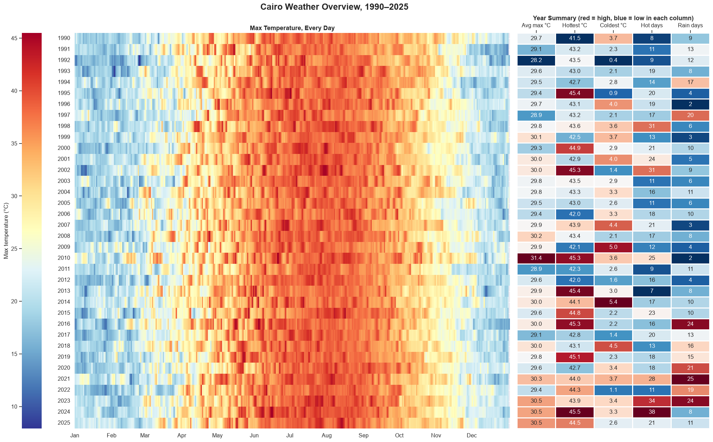

---

## Contents
1. [Goal](#goal)
2. [Results at a glance](#results-at-a-glance)
3. [Data](#data)
4. [Pipeline](#pipeline)
5. [Repository structure](#repository-structure)
6. [EDA process](#eda-process)
7. [Findings](#findings)
8. [Hypotheses H1–H6](#hypotheses-h1h6)
9. [From EDA to the model](#from-eda-to-the-model)
10. [Forecasting setup and baselines](#forecasting-setup-and-baselines)
11. [Next steps](#next-steps)
12. [Limitations](#limitations)
13. [How to run](#how-to-run)

---

## Goal

Understand the data well enough to forecast two things for **tomorrow**:

| Target | Task | Definition |
|---|---|---|
| Mean temperature | Regression | `temp_mean` of the next day (°C) |
| Rain | Classification | Next day has ≥ 1 mm of rain (yes / no) |

---

## Results at a glance

- **The season dominates:** the yearly cycle swings **19.1 °C**; the 36-year trend moves only 2.8 °C.
- **Cairo is warming:** nights **+0.41 °C** and days **+0.23 °C** per 10 years.
- **The 2016 rain jump is most likely a data change**, not real weather, so rain work uses **2016–2025 only**.
- **Short memory:** only the last ~5 days help predict tomorrow; the series is stationary (ADF p < 0.001).
- **Numbers to beat:** **1.05 °C MAE** for temperature (“tomorrow = today”), and **F1 0.47** on test for rain (“rain today → rain tomorrow”).

---

## Data

| | |
|---|---|
| **Source** | [NASA POWER](https://power.larc.nasa.gov/) daily point API (free, no API key) |
| **Location** | Central Cairo, 30.04° N, 31.24° E |
| **Period** | 1990-01-01 to 2025-12-31 · **13,149 days** · no gaps, no duplicates |
| **Variables (8)** | `T2M`, `T2M_MAX`, `T2M_MIN` (mean / max / min temperature), `PRECTOTCORR` (rain), `RH2M` (humidity), `WS2M` (wind speed), `PS` (pressure), `WD2M` (wind direction) |
| **Units** | Already metric (°C, mm/day, %, m/s, kPa, degrees) |
| **Missing value code** | `-999` |

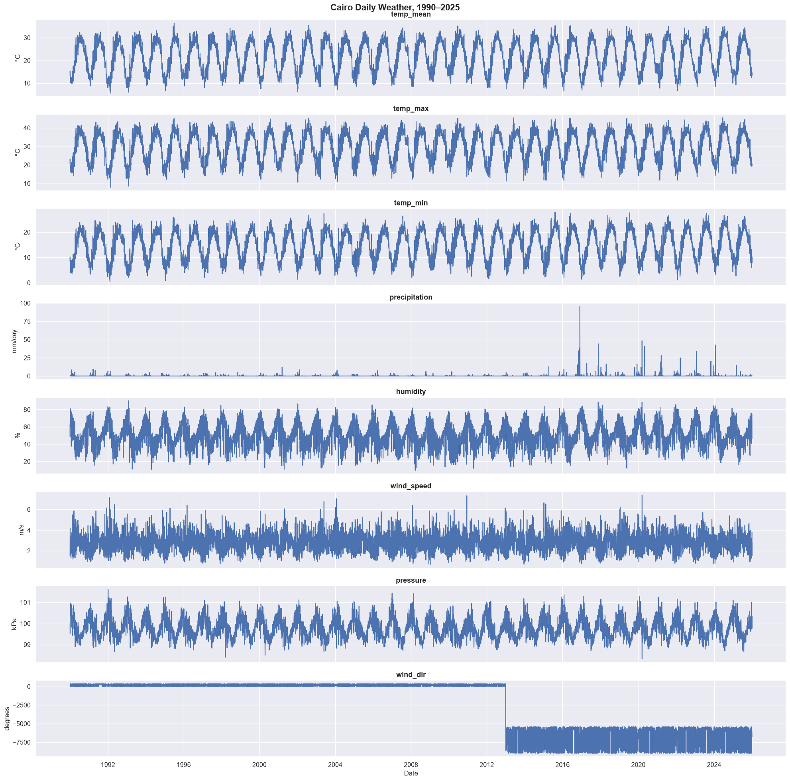

---

## Pipeline

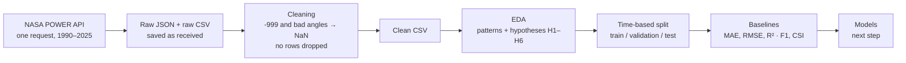

**Rules followed throughout:**
1. The raw data is never changed.
2. No rows are dropped.
3. Wrong values become `NaN`; only short gaps (≤ 3 days) are filled.
4. Real extreme days are kept.
5. Anything learned from the data (normals, thresholds) uses training years only.

---

## Repository structure

```
├── Weather_Predication.ipynb        # full analysis: Parts 1–4 + Appendix
├── Cairo_Weather_Predication.pptx   # presentation slides
├── cairo_weather_raw.csv            # raw data from the API
├── cairo_weather_clean.csv          # cleaned data used in the analysis
├── 01_ … 17_*.png                   # key figures from the notebook
├── requirements.txt
└── README.md
```

| Notebook part | What it covers |
|---|---|
| 1 · Data collection | Call the API, save the raw JSON and a CSV |
| 2 · Preparation | Dates, gaps, duplicates, missing and impossible values, clean CSV |
| 3 · EDA | Descriptive stats, temporal patterns, decomposition and structure, relationships and anomalies, decisions |
| 4 · Forecasting setup | Time split, metrics, baselines to beat |
| Summary | Main findings of Parts 1–4 |
| Appendix | Dashboards, hypotheses H2 and H4–H6, storms |

---

## EDA process

### Part 2 · Understanding and preparing the data

| Step | What was checked | Result |
|---|---|---|
| 2.1 Understand the data | `head`, `tail`, `shape`, `dtypes`, `describe`, `nunique`, `value_counts` | `wind_dir` has values down to −9000 (an angle must be 0–360°) |
| 2.2 Date index, gaps, duplicates | Full daily date range, duplicated dates and rows | 13,149 days, daily frequency, no gaps, no duplicates |
| 2.3 Every variable over time | One line plot per variable | Wind direction breaks from 2013; heavy rain appears only after 2016 |
| 2.4 Missing values | `-999` and negative angles → `NaN` | 4.5 % of the table, all in `wind_dir`: every day from 2013 to 2025 (36 % of the column) |
| 2.5 Impossible values | Negative rain, min > max, humidity outside 0–100 %, negative wind speed | All four checks: 0 |
| 2.6 Decision and save | Short gaps filled (≤ 3 days); wind direction left empty | Clean CSV saved |

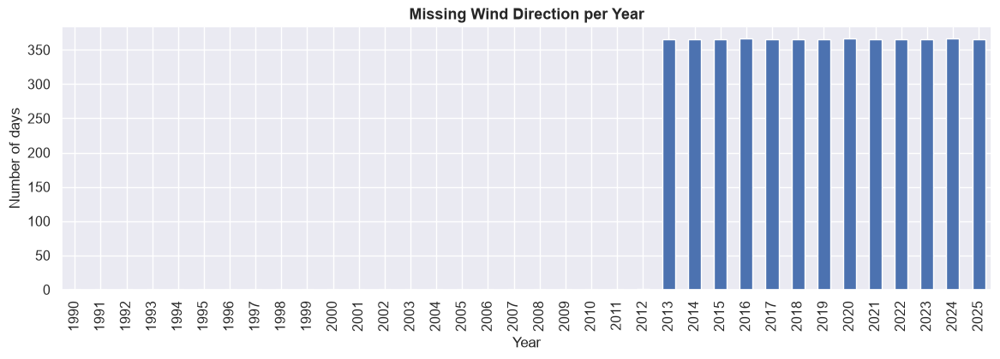

### Part 3 · Exploratory data analysis

| Step | Method | Main finding |
|---|---|---|
| 3.1 Descriptive | Summary stats, skew, rain-day counts, histograms + KDE | Temperature has two peaks (winter ~13 °C, summer ~29 °C); rain skew 28.7; 20.7 % of days have some rain but only **2.9 %** have ≥ 1 mm |
| 3.2 Temporal patterns | Full range, 30- and 365-day rolling means, yearly trend, boxplots by month, rain days by month, weekly check, rolling std | Season dominates; warming (H1); rain jump in 2016 (H3); April moves most (3.4 °C spread), August least (1.2 °C); day of week has no effect |
| 3.3 Decomposition and structure | Additive vs multiplicative decomposition, ACF / PACF, ADF test | Season 19.1 °C, trend 2.8 °C, residual 2.2 °C; only the last ~5 days matter; stationary |
| 3.4 Relationships and anomalies | Spearman correlation (raw and deseasonalized), rolling-window outliers (31 days, \|z\| > 3), suspicious values | Raw links shrink once the season is removed (pressure −0.79 → −0.34); 104 outliers that match real events, kept |
| 3.5 From EDA to modeling | Decision table | See [From EDA to the model](#from-eda-to-the-model) |

---

## Findings

### The season controls everything
The mean temperature goes from about **12 °C in January** (median 12.1 °C) to **30 °C in July–August** (July median 29.9 °C). Humidity moves the opposite way: hotter days are drier. Rain falls from October to April, and the 2020s have the hottest summers.

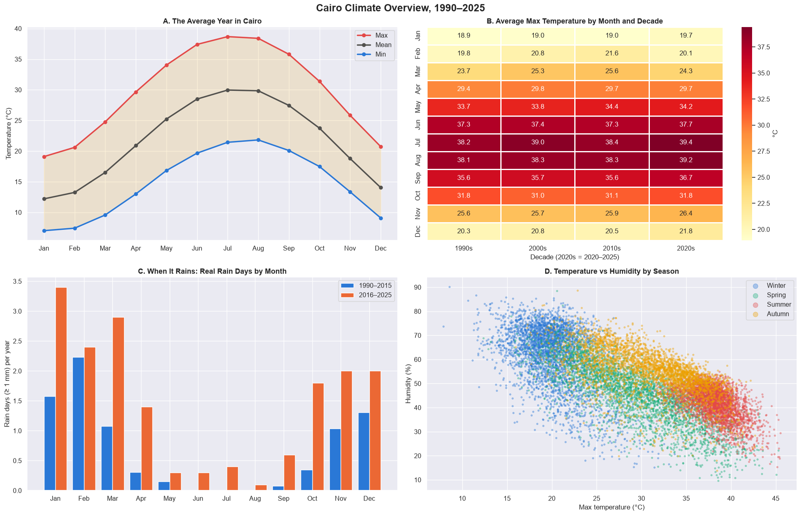

Each day compared with the normal for its date: the 1990s are mostly colder than normal, recent years mostly warmer.

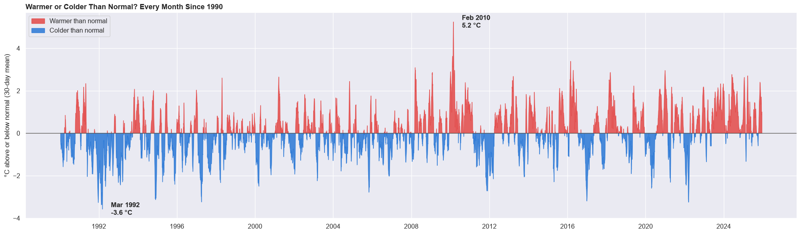

### Time-series structure

| Check | Result | Decision |
|---|---|---|
| Decomposition (period = 365) | Additive and multiplicative agree. Season swing **19.1 °C**, trend change **2.8 °C**, residual **2.2 °C** | Additive form; the model’s real job is the 2.2 °C left over |
| ADF test | Raw, deseasonalized and differenced series are all stationary (**p < 0.001**) | No differencing, but the season is still modeled |
| ACF (temperature) | **0.97** at lag 1, −0.86 at 6 months, +0.86 at 1 year | The yearly wave is the season |
| ACF / PACF (daily change) | Only the last **~5 days** matter | Inputs: the last 1–5 days |
| Lag check (season removed) | Today **0.77**, a week ago **0.13**, a year ago **≈ 0** | Drop lag 365 |
| ACF (rain day, 2016–2025) | After a rain day, rain tomorrow is **39 %** likely vs **5 %** normally | “Rain today” is the strongest rain clue |

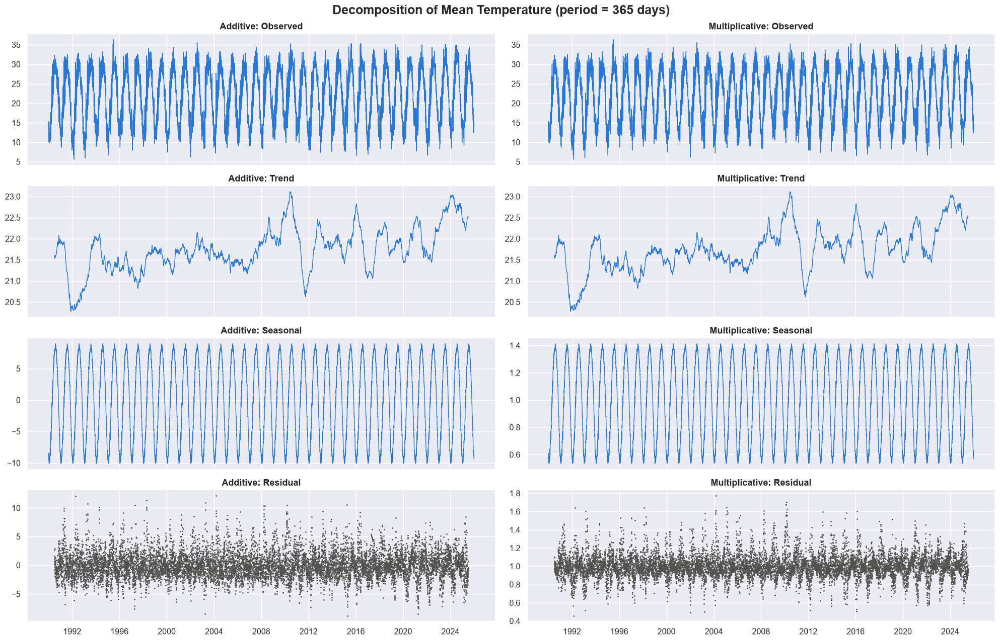
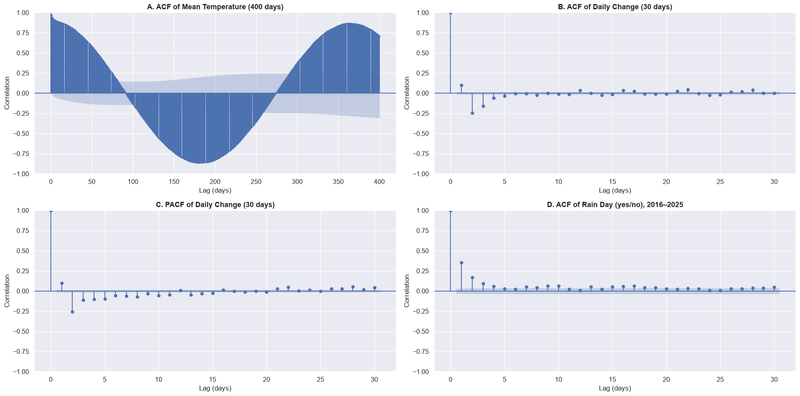

### Outliers are real weather
Each day is compared with the 31 days around it (|z| > 3), so normal summer heat is not flagged. One fixed threshold finds **no** temperature outliers; the rolling window finds **104** across 5 variables, in every month, with no rise over time. They match real events (storms, cold spells), so they are kept. Five jumps of more than 8 °C in one day (all in spring) are kept; the 95.5 mm day (30 Nov 2016) is flagged.

| Variable | Fixed threshold | 31-day window |
|---|---|---|
| Max temperature | 0 | 12 |
| Min temperature | 0 | 18 |
| Humidity | 7 | 30 |
| Wind speed | 70 | 34 |
| Pressure | 19 | 10 |

---

## Hypotheses H1–H6

| # | Question | Answer |
|---|---|---|
| **H1** | Is Cairo warming, and are nights warming faster than days? | **Yes.** Nights +0.41 °C, days +0.23 °C per 10 years |
| **H2** | Are very hot days (max > 40.1 °C) becoming more frequent? | **Partly.** 7 in 2013 vs 38 in 2024; 2023 and 2024 are the highest, but more years are needed to call it a trend |
| **H3** | Did heavy rain really increase after 2016, or did the data change? | **Most likely the data** |
| **H4** | Are cold waves (min < 5.7 °C) becoming rarer? | **Yes, slowly.** 20.4 nights per year (1990s) to 15.5 (2020s), −1.9 per 10 years; coldest years 1992–1993 |
| **H5** | Do storms show warning signs in the days before? | **Partly.** Heat waves and cold snaps build up over days; storms don’t |
| **H6** | Can Khamasin-like days be detected? | **Yes.** 125 days in 1990–2012, mostly December to April |

### H1 · Cairo is warming, and nights faster than days
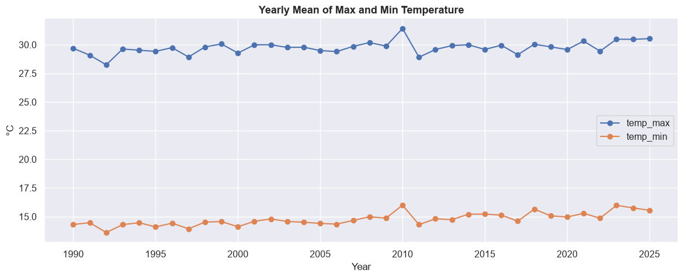

### H2 + H4 · More very hot days, fewer very cold nights
| Very hot days per year (H2) | Very cold nights per year (H4) |
|---|---|
| 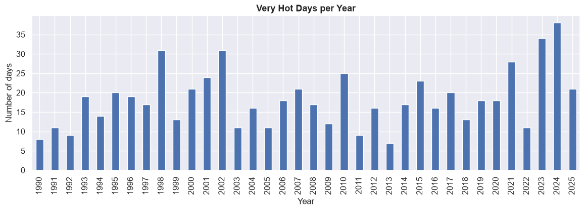 | 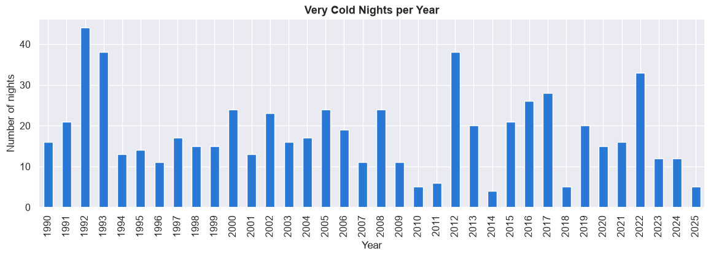 |

### H3 · Did it really rain more after 2016?

| | 1990–2015 | 2016–2025 |
|---|---|---|
| Rain days (≥ 1 mm) per year | 8.1 | 17.6 |
| Heavy rain days (≥ 10 mm) per year | 0.1 | 3.8 |
| Total rain per year | 30.6 mm | 142.0 mm |
| Biggest rain day of the year (average) | 5.5 mm | 36.6 mm |

Three reasons this is most likely a change in the data, not the weather:
1. **Sudden:** the jump happens at one year, not as a slow rise.
2. **Unrealistic:** 142 mm a year vs Cairo’s normal of about 20–25 mm.
3. **Storms did not get stronger:** a storm score built from signs that are consistent across all 36 years (pressure drop, wind, temperature drop, humidity) stays flat, and **7 of the 10 strongest storms are before 2016**, most with little rain.

**Decision:** all rain work uses 2016–2025 only.

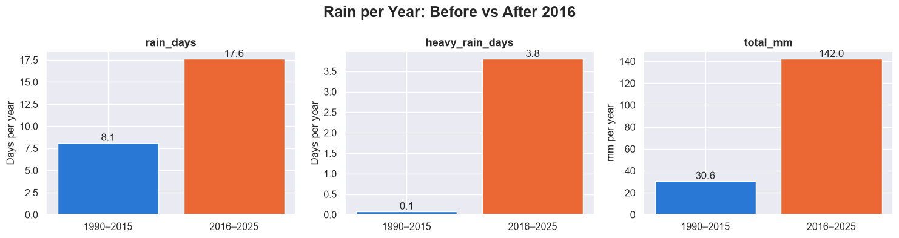
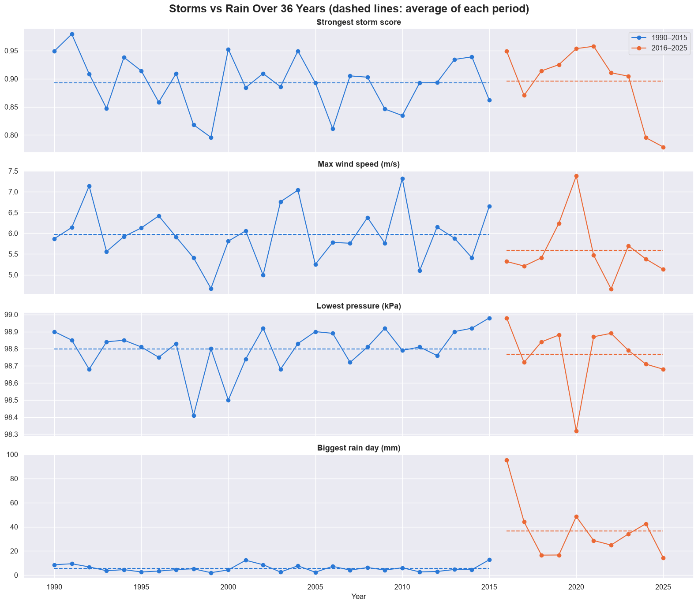

| Top 10 storms in 36 years | Storm anatomy: 22 Mar 1991 vs 12 Mar 2020 |
|---|---|
| 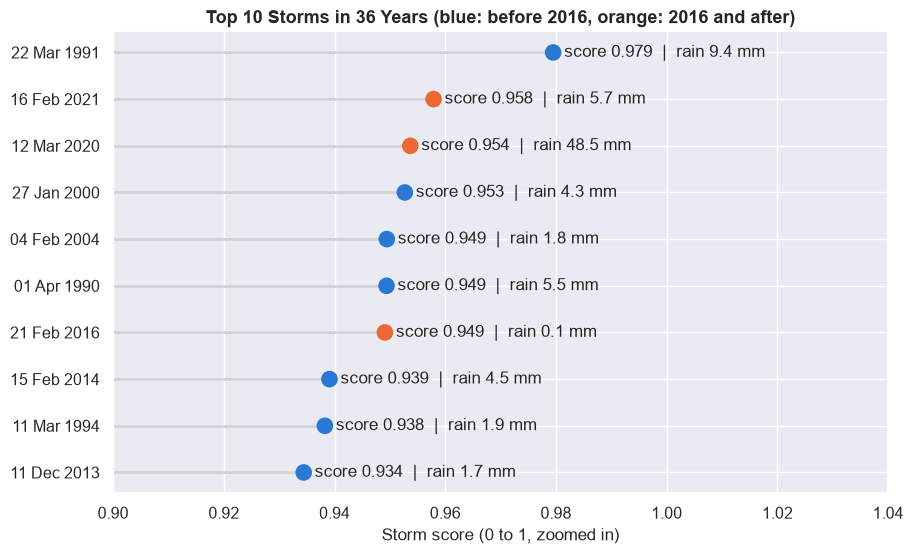 | 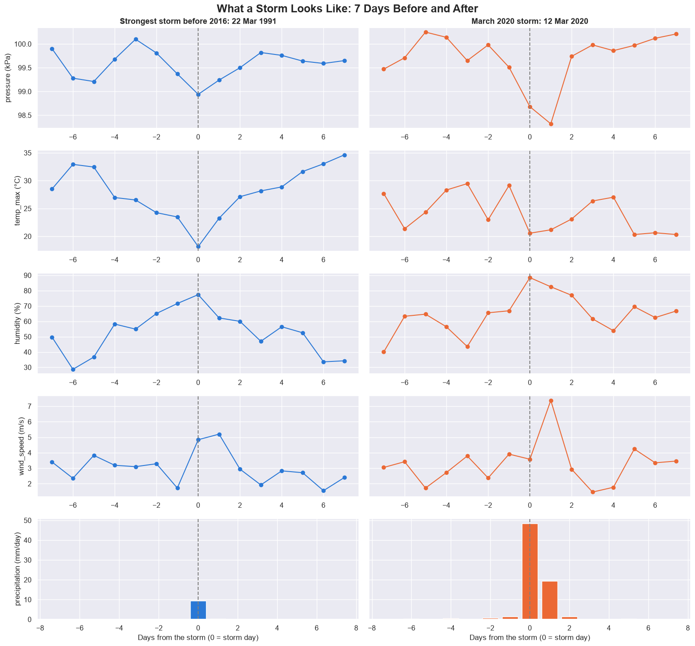 |

Both storms follow the same steps (pressure falls, humidity rises, temperature drops), but the March 2020 storm gives about 5 times more rain.

### H5 · Do storms give early warning?
All links between each sign (1–7 days before) and a storm starting are tiny (−0.06 to +0.05). Heat waves and cold snaps build up over several days; storms show mostly on the day itself.

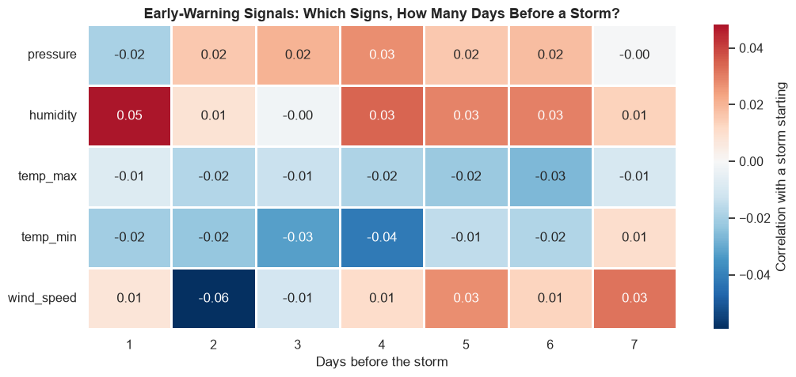

### H6 · Khamasin-like days
Defined from the data (not officially): south wind (135°–225°), max temperature ≥ 1.5 std above normal and humidity ≥ 1.5 std below normal. **125 days** in 1990–2012, mostly December to April (a wider season than the usual March–May), much hotter and drier than normal, with low pressure. Wind direction stops in 2012, so this cannot be a model feature.

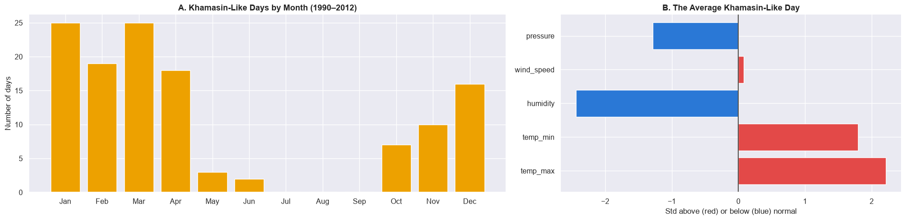

---

## From EDA to the model

| What we found | What we do |
|---|---|
| A strong, fixed yearly season | Day of year as sine and cosine |
| Temperature returns to its level (ADF) | No differencing |
| Only the last few days help | Lags 1–5; no lag 365 |
| Slow warming; the test years are the warmest | Watch for a cold bias on test |
| Spring is the hardest season | Report errors by month |
| Humidity and pressure add information | Use them as inputs |
| Rain is rare and changed in 2016 | Rain yes/no on 2016–2025 only, judged by F1 and CSI |
| Wind direction stops in 2012 | Not used |
| Outliers are real weather | Keep them |

---

## Forecasting setup and baselines

### Time-based split
The split is by time, never random, so a model never sees the future. Validation chooses settings; test is used once, at the end.

| | Temperature | Rain |
|---|---|---|
| Train | 1990–2019 · 10,957 days | 2016–2020 · 1,827 days · 89 rain-tomorrow days (4.9 %) |
| Validation | 2020–2022 · 1,096 days | 2021–2022 · 730 days · 44 rain-tomorrow days (6.0 %) |
| Test | 2023–2025 · 1,095 days | 2023–2025 · 1,095 days · 43 rain-tomorrow days (3.9 %) |

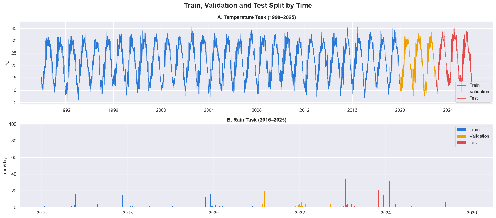

### Metrics

| Task | Metric | Meaning |
|---|---|---|
| Temperature | **MAE** | Typical error in °C |
| | **RMSE** | Like MAE, but punishes big misses more |
| | **R²** | Share of the variation explained |
| Rain | **Hits / Misses / False alarms** | Counts, shown first because rain days are few |
| | **Precision / Recall / F1** | Quality of the “rain” predictions |
| | **CSI** | Hits out of all days where rain was forecast or happened |
| | Accuracy | Shown but not used to choose: about 95 % of days are dry |

### Temperature baselines (tomorrow’s mean temperature)

| Baseline | Val MAE | Val RMSE | Val R² | Test MAE | Test RMSE | Test R² |
|---|---|---|---|---|---|---|
| **Persistence (tomorrow = today)** | **1.07** | **1.49** | **0.96** | **1.04** | **1.44** | **0.96** |
| Mean of last 7 days | 1.59 | 2.14 | 0.91 | 1.54 | 2.06 | 0.91 |
| Climatology (normal for tomorrow, train years) | 1.84 | 2.40 | 0.88 | 1.79 | 2.33 | 0.89 |
| Same day last year | 2.56 | 3.35 | 0.77 | 2.27 | 2.93 | 0.82 |

### Rain baselines (rain tomorrow, ≥ 1 mm)

| Baseline | Val F1 | Test F1 | Note |
|---|---|---|---|
| Always no rain | 0.00 | 0.00 | 94 % (val) / 96 % (test) accurate, but 0 rain days caught |
| **Persistence (rain today → rain tomorrow)** | **0.36** | **0.47** | Best: rain comes in groups of days |
| Seasonal guess (random, month’s chance) | close to 0 | close to 0 | No useful skill |

**A model must beat about 1.05 °C MAE for temperature, and persistence (F1 0.47 on test) for rain.**

---

## Next steps
1. **Data for deployment:** pull the same variables from Open-Meteo (history and the latest days), so the model is trained on the same source it will use live.
2. **Features:** day of year (sine and cosine), the last 1–5 days, humidity and pressure.
3. **Models:** Ridge, gradient boosting and SARIMAX for temperature; logistic regression for rain.
4. **Validation:** walk-forward, one year at a time; the test years (2023–2025) are used once.
5. **Deploy** only if a model clearly beats the baselines.

## Limitations
- **Model data, not a station:** values are averages over about 50 × 50 km, so extremes may look milder.
- **Rain is the weakest variable:** amounts jump in 2016, so rain work uses 2016–2025 only, and the test period has only 43 rain days.
- **Wind direction** is valid for 1990–2012 only.

---

## How to run

```bash
pip install -r requirements.txt
jupyter notebook Weather_Predication.ipynb
```

The raw API response (JSON) and the raw and clean CSV files are included. Running the notebook from the start calls the NASA POWER API again and recreates them.

